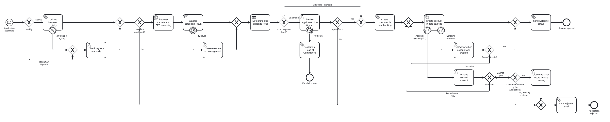

# Kilima Bank: SME account onboarding on Camunda 8.9

Business account opening for SMEs in Kenya, Tanzania and Uganda: an executable BPMN process, a DMN
decision, job workers in Java 21 / Spring Boot 4, and tests with Camunda Process Test.



## What's in the repo

| Path | What |
| --- | --- |
| `src/main/resources/bpmn/sme-onboarding.bpmn` | The process (Camunda 8.9) |
| `src/main/resources/dmn/due-diligence-level.dmn` | Due diligence decision (simplified / standard / enhanced) |
| `src/main/resources/forms/` | Tasklist forms for the six user tasks |
| `corebanking/` | Core banking client, worker, rate limiter, maintenance window |
| `utils/CommonUtils` | Job types, BPMN error codes and message names shared by the workers and the model |
| `registry/`, `screening/`, `notification/` | The other workers, the screening callback endpoint (`CallbackController`) and the email service |
| `stub/` | Stand-ins for core banking, registry and screening (profile `stub`, local runs only) |
| `src/test/` | Unit tests for the worker and client, process tests with Camunda Process Test |
| `scripts/start-application.sh` (`.ps1`, `.cmd` on Windows) | Submits an application through the Camunda REST API |

## How to run it

Prerequisites: Java 21, Camunda 8 Run 8.9, and Docker (or Colima) for the process tests. Maven comes with
the wrapper (`./mvnw`, or `mvnw.cmd` on Windows).

```bash
# 1. Start Camunda 8 Run 
./start.sh

# 2. Start the workers and the stubs. Deploys the BPMN, DMN and forms on startup.
./mvnw spring-boot:run -Dspring-boot.run.profiles=stub

# 3. Start applications
scripts/start-application.sh APP-1001 KE                      # happy path
scripts/start-application.sh APP-MATCH-1002 KE                # screening match -> compliance review
scripts/start-application.sh APP-1003 TZ                      # manual registry check by staff
scripts/start-application.sh APP-1004 KE PVT-ACC422-1004      # account rejected (422) -> resolve task
scripts/start-application.sh APP-1005 KE PVT-ACCTIMEOUT-1005  # account outcome unknown -> verify task
scripts/start-application.sh APP-1006 KE PVT-CUST422-1006     # customer rejected -> incident
```

On Windows, use `scripts\start-application.cmd APP-1001 KE` (Command Prompt or Cmder) or
`scripts\start-application.ps1 APP-1001 KE` (PowerShell) with the same arguments.

Open Operate and Tasklist at http://localhost:8080  creds: (demo / demo). The stubbed screening service calls
back after 10 seconds. To run against SaaS instead, set `camunda.client.mode=saas` and the cluster
credentials (`camunda.client.auth.client-id`, `camunda.client.auth.client-secret`,
`camunda.client.cloud.cluster-id`, `camunda.client.cloud.region`).

### Tests

```bash
./mvnw test
```

* `CoreBankingWorkerTest` and `CoreBankingClientTest`: retry and error decisions, HTTP
  classification (429, 503, 422, 500, read timeout, connection refused). No Docker needed.
* `SmeOnboardingProcessTest`: the model with all workers mocked. Happy path, screening match to
  compliance review with the 48-hour escalation (clock moved forward), compliance rejection,
  account outcome unknown, Tanzanian manual registry check, and a duplicate submission that is
  rejected without starting a second instance.
* `CoreBankingFailureProcessTest`: the **real** core banking worker against the model, with core
  banking stubbed by WireMock. A 422 on the account leads to closing the customer we created, and a
  retry after fixing the data reuses the same customer (WireMock verifies one `POST /customers`).

The process tests start Camunda in Docker through Testcontainers. Without Docker, run them against
Camunda 8 Run with `camunda.process-test.runtime-mode=remote` (the clock must be controllable for the
48-hour test: start Camunda with `CAMUNDA_SYSTEM_CLOCKCONTROLLED=true`).


## Design decisions

* **The portal starts the process with a message.** It publishes `ApplicationSubmitted` with `applicationId` as both the correlation key and the message ID. A second submission of the same application is rejected (409), so one application can never open two accounts.
* **Screening is a request and a receive task.** The result can take up to 24 hours, so the process waits instead of a worker. After 26 hours, compliance ops get a task to chase it.
* **The DMN decides the review path.** A screening match returns `enhanced`, so one gateway sends both matches and enhanced cases to compliance review. Hit policy FIRST, with the match rule at the top.
* **48-hour escalation is non-interrupting.** The Head of Compliance is notified, and the review task stays open.
* **Customer and account are separate tasks.** If the account step fails, the customer step doesn't run again, and the `customerId` is already in the process.
* **A rejected account (422) never leaves an orphaned customer.** Ops either fix the data and retry with the same customer, or the customer is closed. It is only closed if this application created it.
* **An account timeout goes to a person.** There's no way to look up accounts, so a blind retry could open a second one. Someone checks core banking first.

## Core banking error handling

| Situation | What happens | Uses a retry? |
| --- | --- | --- |
| 00:00-02:00 EAT maintenance window | No call. The job waits until 02:00, plus a few random minutes | No |
| Our limit of 18 calls a minute is reached | No call. The job waits for the next free slot | No |
| Customer already exists | Reused, no second POST | - |
| 429, 503, connection refused | Retried with backoff from 15s up to 15m. `Retry-After` wins if it's longer | Yes |
| Customer POST times out | Retried. The next attempt looks the customer up first | Yes |
| Account POST times out, or 500/502/504 | BPMN error, a person checks the account | - |
| Account 422 | BPMN error, ops fix the data or close the customer | - |
| Customer 422, 401 or anything unexpected | Incident in Operate | - |

Core banking tasks have 10 retries. When they run out, Camunda raises an incident.

## Assumptions

* `GET /customers?registrationNumber=` returns the customer or 404.
* Core banking stores an external reference on the customer. I send `applicationId`, so I can tell a customer from an earlier attempt apart from an existing bank customer.
* There's no API to close a customer, so it's a manual task.
* The screening service calls back with `applicationId`, a request ID, the match flag and a reference.
* The core banking limit of 20 calls a minute is ours alone: no other bank systems use the same allowance.

## Questions for the client

1. Only customers have a lookup. After a timeout on `POST /accounts`, is there any way to find out whether the account was created, for example by listing a customer's accounts? Without it, a person has to check core banking by hand.
2. Do other bank systems call core banking under the same 20 calls a minute limit? If so, how much of it can this service use?
3. How is a customer closed in core banking, and who is allowed to do it?
4. The screening callback endpoint has no authentication in this demo. Can the provider sign its callbacks (HMAC) or use mTLS, so the service only accepts genuine results?

## Use of AI tools

I used an AI assistant as a pair programmer to generate an initial version of the process model, workers, and tests, and to help draft parts of this README.

I treated that output as a starting point, not a finished solution. I set up the service, modelled the process in Camunda Modeler, worked on the DMN decision table and forms, and rebuilt the solution within this repository.

I deployed and tested the different process paths against Camunda 8 Run, validating their execution in Operate and Tasklist. During testing, I identified a duplicate-submission scenario where the same application could result in two accounts being opened. This prompted me to rethink the process initiation and introduce application-ID-based message correlation.

I take ownership of the final implementation and design decisions, and I can explain, validate, and modify any part of the code, process models, or configuration.